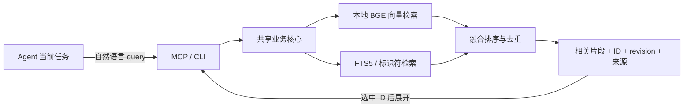

# Shared Agent Memory

[English](README.en.md) · [协议](docs/protocol.md) · [维护](docs/operations.md) · [按需检索架构](docs/retrieval-architecture.md) · [MIT](LICENSE)

供同一台机器上的多个 AI Agent 共用的本地记忆服务。提供标准 **MCP STDIO** 和 **CLI**，用本地 embedding、关键词和代码标识符检索，按当前任务返回相关片段。

Agent 可以搜索全库，不需要预先分配任务可见清单；需要完整记录时，再按 ID 读取。每条记忆保留来源、项目归属和版本。各个 agent harness 的 MCP 配置由使用者接入。

## 能做什么

- **按需检索**：本地 BGE 向量与 FTS5 融合排序，支持中文语义、精确代码和路径检索。
- **跨 Agent 共享**：多个 MCP 子进程和 CLI 访问同一 SQLite 数据库，更新立即对后续查询可见。
- **可追溯的编辑**：候选与已发布记忆分开；更新保留 ID、递增 revision，冲突不会静默覆盖。
- **明确遗忘**：清理正文、索引、依赖记录及受管理导出，撤销清单阻止旧导出恢复已遗忘内容。
- **可维护**：索引重建、完整性检查、导出与导入；模型不可用时明确标记关键词降级。



普通查询先在授权范围内做 cosine KNN、Chunk FTS 和标识符索引检索，排序后只加载入选记录的元数据与最多两个命中片段；不会在 Node 中读取或解析全库正文。相邻命中片段合并，按 ID 才展开完整正文。

这是检索式的按需注意：不把整个记忆库放入每次对话。向量相似度表示相关性，是否足以支持结论仍由 Agent 结合来源判断。

## 安装

需要 **Node.js 24.18.0**、npm、Python 3 和 Git。路径处理面向 macOS/Linux；不提供 Windows 原生路径支持。当前默认模型为面向中文的 `bge-small-zh-v1.5`，使用 CPU、FP32、512 维 CLS/L2 编码。

```sh
git clone https://github.com/logex-linux/shared-agent-memory.git ~/.agents/shared-agent-memory
cd ~/.agents/shared-agent-memory
nvm install
nvm use
npm ci
npm run build
npm run model:download
npm run setup -- --project /absolute/path/to/your-work-project
```

`nvm` 是选择固定 Node 版本的一个方式；已有相同版本时可直接使用。模型下载是显式安装步骤，固定上游 revision 并核对 SHA-256；服务运行时不下载模型。

默认数据目录是 `~/.local/share/shared-agent-memory/`，含数据库、模型、配置和生成的客户端模板。程序可放在 `~/.agents/shared-agent-memory/`，让不同 Agent 指向同一个入口。安装器不覆盖已有配置，也不自动修改任何客户端设置。

自定义数据目录：

```sh
npm run setup -- --root "$HOME/.local/share/my-agent-memory" --project /absolute/path/to/project
```

安装必须显式指定真实工作项目，服务代码目录与工作项目目录分别记录，不默认把服务仓库注册成你的项目。安装结果会输出项目 UUID 和配置绝对路径。新安装的库为空，不含个人记忆、聊天记录或预置的用户偏好。

## 接入 MCP

安装器生成三套连接配置：`config.json` 默认只读（可全库搜索）、`project.config.json` 仅目标项目读写、`admin.config.json` 全局管理及核验。对应的[只读](examples/configs/read-only.json)、[项目读写](examples/configs/project-rw.json)、[管理员](examples/configs/admin.json)示例可供检查。默认只给日常 Agent 只读配置；写配置由操作者显式选择，服务端按操作与项目范围拒绝越权。

在 `client-configs/read-only/`、`client-configs/project-rw/`、`client-configs/admin/` 生成对应客户端模板；使用其中已填好的 Node、server 和 config 绝对路径，按客户端格式接入。通用定义如下，也可参考 [示例配置](examples/mcp.json)：

```json
{
  "mcpServers": {
    "shared_memory": {
      "command": "/absolute/path/to/node",
      "args": ["/absolute/path/to/shared-agent-memory/dist/mcp/server.js"],
      "env": {
        "SHARED_MEMORY_CONFIG": "/absolute/path/to/data/config.json"
      }
    }
  }
}
```

JSON 中使用实际绝对路径，不依赖客户端展开 `~` 或 `$HOME`。模板包含 Codex、Claude Code、Pi、StepCode、Hermes 和 DSH 的配置参考，外层格式及工具审批以所用客户端版本为准。旧版 Pi 的可选桥见 [adapters/pi-stdio.mjs](adapters/pi-stdio.mjs)。

## 搜索和阅读

Agent 调用 `memory_recall`，只需描述当前任务需要的经验：

```json
{"query":"重新编译后录屏权限失效，之前有哪些排查办法？","limit":3}
```

默认公共配置启用 `all_projects: true` 和 `allow_global: true`：不传 `project_id` 时跨项目搜索，也包含 global 记忆。需要聚焦某个项目时，可选传 `project_id`；这时默认不包含 global，可用 `include_global: true` 加入。

返回相关片段、ID、revision、所属项目、来源与适用条件。查询含代码标识符时，精确命中只提供有限排序加权，不会排除语义相关记录；严格标识符筛选需要显式设置 `exact_only: true`。选中后，用同一工具的 `ids` 参数读取完整正文：

```json
{"ids":["11111111-1111-4111-8111-111111111111"]}
```

上面的 ID 只是格式示例，应替换为真实检索结果。默认最多返回 5 条，`limit` 最多 10 条；`token_budget` 可下调单次预算，服务端 `response_token_budget` 默认 6000。Token 按紧凑 JSON 的 UTF-8 bytes / 3 向上估算，不是指定 LLM 的 tokenizer。正文合计最多 5000 字符，JSON payload 最多 32000 bytes；预算截断保留来源并标记 `truncated`。空结果和 `insufficient` 是正常结果，不能据此编造历史。

## 工具与权限

| 工具 | 用途 |
|---|---|
| `memory_recall`（默认只读连接唯一工具） | 自然语言/标识符检索，或按 ID 展开记录 |
| `memory_propose` | 持久化候选，尚不可被正常检索 |
| `memory_commit` | 原子发布候选、向量和关键词索引 |
| `memory_forget` | 遗忘记录及依赖，返回受管理副本清理结果 |

新增：`propose → commit`，首次 `expected_revision` 为 `0`。编辑：先读取，propose 时传 `target_id` 与当前 `expected_revision`，再 commit。遗忘也需要当前版本。每次逻辑写请求使用新的 UUID；同一请求重试复用原 UUID，避免重复写入。

写入记录必须有来源和核验说明，并保留项目归属或 global 标记。核验状态独立于相关性，默认为 `unverified`；`disputed` 表示存在争议，`verified` 必须由拥有 verify 能力的配置提供依据并留存真实核验身份。来源字段齐全、模型自称核验或向量相似度高都不会自动提升状态。仅在用户明确要求记住、更新、忘记，或已有相应授权时写入。完整参数见 [协议与示例](docs/protocol.md)。

## CLI

CLI 与 MCP 使用同一业务核心和数据库。在仓库目录执行：

```sh
export SHARED_MEMORY_CONFIG="$HOME/.local/share/shared-agent-memory/config.json"
npm run cli -- recall --input examples/recall.json
# 管理操作使用显式管理员配置
npm run cli -- inspect --config "$HOME/.local/share/shared-agent-memory/admin.config.json"
npm run cli -- check --config "$HOME/.local/share/shared-agent-memory/admin.config.json"
```

`propose`、`commit`、`forget` 同样通过 `--input /absolute/path/to/arguments.json` 读取参数，结构与 MCP 一致。新项目注册、备份、迁移与停用见 [维护文档](docs/operations.md)。

## 开发与测试

完成依赖和模型安装后：

```sh
npm test
```

测试使用合成记录和临时数据库，覆盖语义检索、可选项目筛选、官方 MCP SDK STDIO 调用、更新与幂等、遗忘、四进程 400 次发布、版本竞争和 10 个 SIGKILL 恢复点。生成的报告在 `test-results/`，不提交到仓库。新增回归覆盖标识符与语义并存、恢复数组撤销、只读拒写、服务端写入身份、核验状态及工作项目映射；GitHub Actions 在 Linux 执行同一套检查。

100 / 1,000 / 10,000 条真实向量的 p50/p95、RSS 与 Recall@5 实测及检索方案决策见[规模测试](docs/scale-benchmark.md)。

## 使用边界

权限来自操作者配置，不是对自然语言“用户授权”的自动识别。持有写连接的 Agent 具有相应能力，逐次人工审批仍由 harness 管理。`author_client` 是自报来源；`written_by`、事件 connection_id 和核验 reviewer 来自服务端连接配置。

本项目是同机本地服务；不提供远程 HTTP 服务或操作系统级租户隔离。本地 embedding 不代表 Agent 模型调用离线：检索出的片段会进入所连接客户端的上下文。记忆正文是证据，不能把夹带指令当作工具授权。

遗忘不能撤回已经进入聊天上下文的内容，也不承诺清除非托管备份、系统快照或 SSD 物理残留。正文与索引是同一数据库中的数据，导出和撤销文件采用可重试维护，恢复时需要最新撤销清单。

## 目录与许可

`src/` 是业务核心、存储、编码、检索、MCP 与 CLI；`tests/` 是合成集成测试；`scripts/` 提供模型安装和配置生成；`docs/` 是协议和维护说明。

代码采用 [MIT](LICENSE)。依赖和模型各自遵循上游许可，模型权重不随仓库分发，见 [第三方来源](THIRD_PARTY_NOTICES.md)。
